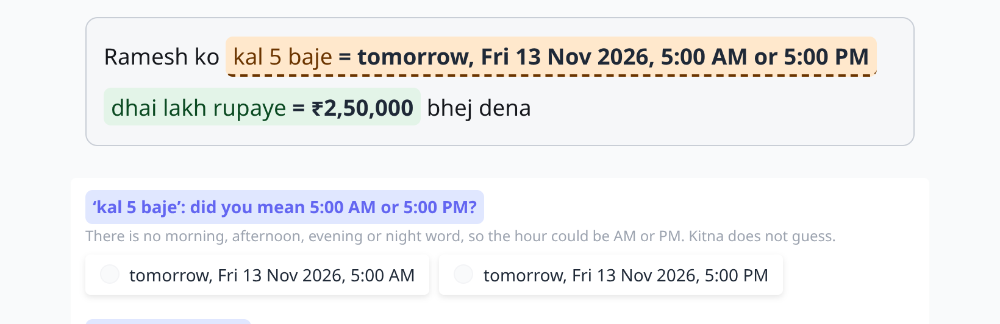
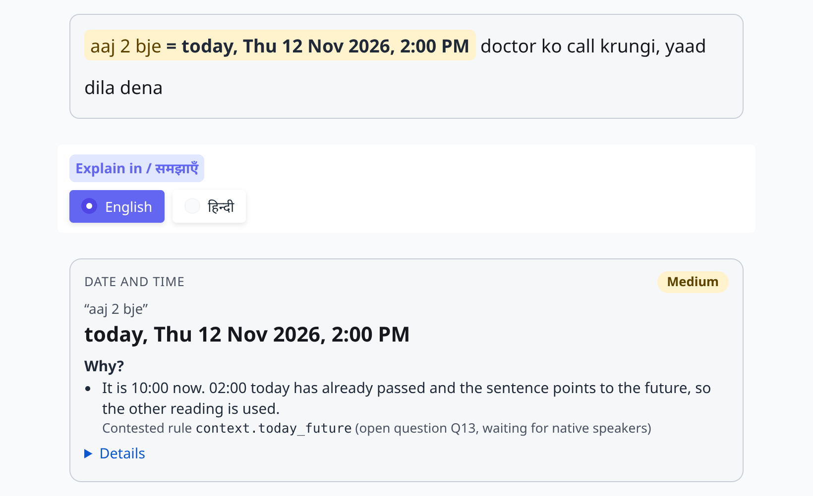
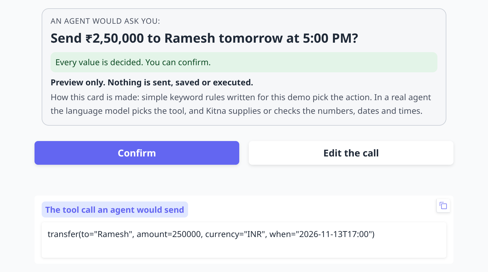

# Kitna

**Indian agents misread "dhai lakh", "parso", "saade teen baje". Kitna reads them exactly, or tells you it's unsure.**

> **Status: pre-alpha (0.1.0.dev0), not on PyPI.** The parser is built but
> **has no accuracy figure**: one native Hindi speaker has reviewed the draft cases
> ([review log](docs/review/REVIEW_LOG.md)), but the independent held-out set does not exist. The benchmark
> tooling runs end to end on a mock model, but **the benchmark itself does not
> exist yet and no model has been run**: it needs utterances written and labelled
> by native speakers. [What is done and what is not](#status).

The first sentence is the problem Kitna is built for, not a measured result: no
model has been run yet, so there is no figure for how often agents get these wrong.

| It asks instead of guessing | It uses the clock and the verb | It shows the action before anything runs |
|---|---|---|
|  |  |  |

Screenshots of the local demo (`python demo/app.py`, see [demo/README.md](demo/README.md)). It is not hosted anywhere yet.

## Quickstart in 60 seconds

```bash
pip install "git+https://github.com/Saparajeeta/Kitna"
```

```python
import datetime, kitna
for r in kitna.parse("Ramesh ko kal 5 baje dhai lakh rupaye bhej dena", relative_base=datetime.datetime(2026, 11, 12, 10)):
    print(r.text, "->", r.canonical, "(ambiguous)" if r.ambiguous else "")
```

```text
kal 5 baje -> 2026-11-13T05:00 | 2026-11-13T17:00 (ambiguous)
dhai lakh rupaye -> INR 250000
```

Check a model's tool call against what the user actually said:

```python
review = kitna.postprocess_tool_call({"name": "transfer", "arguments": {"amount": 25000}}, "Ramesh ko dhai lakh rupaye bhej do")
print(review.arguments, "|", review.reviews[0].reason)
```

```text
{'amount': 250000} | the message says 'dhai lakh rupaye' = 250000; the call had 25000 (off by a factor of 10: a scale slip)
```

(The wrong `25000` above is typed by hand to show the check; it is not a model's output.)

| I want to | Do this |
|---|---|
| Try it in a browser | `pip install -e ".[demo,compare]"` then `python demo/app.py` ([demo/README.md](demo/README.md)) |
| Call it over HTTP | `pip install "kitna[serve] @ git+https://github.com/Saparajeeta/Kitna"` then `kitna serve`; API page at `http://127.0.0.1:8000/docs` |
| Run it in Docker | `docker build -t kitna . && docker run --rm -p 8000:8000 kitna` |
| Guard an agent's tool calls | `python examples/tool_call_guard.py` (offline, mock model); [docs/integrations.md](docs/integrations.md) |
| Help as a Hindi speaker | Open the demo's `/review` page, answer some cards, send back the CSV |

Kitna ("how much") is two things:

- **A Python library** that converts Hinglish (Romanized Hindi mixed with
  English) and Devanagari quantities, money, times and dates into exact
  canonical values, with explicit ambiguity flags instead of silent guesses.
- **A benchmark** of tool-calling tasks in Indian contexts, in Devanagari,
  Romanized Hinglish and English, that measures how well LLMs fill tool
  arguments. Grading uses the library.

## Why

- The Hindi function-calling benchmark we examined (BFCL-Hi) is machine
  translated from English and keeps English function schemas.
- Romanized Hinglish is covered only thinly: one ordering benchmark with
  not-yet-reviewed Hinglish scenarios, and one mechanically romanised version
  of BFCL.
- The Hindi number and date parsers we examined handle Devanagari, not Roman
  script, and have no fraction idioms (dhai, dedh, saade) or ambiguity output.
  In our phase-1 probe, number-parser parsed 2 of 82 Roman-script number cases
  and dateparser 3 of 91 Roman-script date/time cases, all five being plain
  English inputs. The cases are our own unreviewed drafts, built to target
  this gap. Source: [results/phase1/baseline_probe_summary.json](results/phase1/baseline_probe_summary.json).

Details, caveats and what these projects do well: [docs/related_work.md](docs/related_work.md).

## What works today

```console
$ kitna parse "kal subah saade saat baje 2.5 lakh rupaye bhej dunga" --base 2026-11-12
datetime	2026-11-13T07:30	confidence=1.0	'kal subah saade saat baje'
money	INR 250000	confidence=1.0	'2.5 lakh rupaye'
$ kitna parse "kal shaam sawa paanch baje" --base 2026-11-12
datetime	2026-11-11T17:15 | 2026-11-13T17:15	confidence=1.0  [ambiguous]	'kal shaam sawa paanch baje'
```

```python
import datetime
import kitna
kitna.parse("paune do lakh rupaye")[0].canonical        # 'INR 175000'
kitna.parse("do se teen hazaar rupaye")[0].canonical    # 'INR 2000..INR 3000'
kitna.parse("5 baje")[0].candidates                     # 05:00 and 17:00, ambiguous=True
kitna.parse("mujhe paani de do")                        # []  ("do" is the verb)
kitna.parse("no one came")                              # []  (English "one" needs an anchor)
kitna.parse_date("26 January", datetime.date(2026, 11, 12), prefer="future").canonical   # '2027-01-26'
```

`kal` with no tense cue is returned as both yesterday and tomorrow; nothing is
picked silently. Confidence is an ordering, not a probability.

Relative dates need a "today". Pass `relative_base=`; without it the system
clock is used and the result carries a `warnings` entry. `strict=True` raises
instead, and `now=` injects a clock for tests. `Result.to_dict()` gives a
versioned JSON form (schema: `src/kitna/data/result.schema.json`).

More examples, all executed by the test suite: [docs/quickstart.md](docs/quickstart.md).

## Status

| Piece | Status | Evidence |
|---|---|---|
| Parser: numbers, fractions, money, ranges, times, durations, dates | built, **in review** (waiting for native speakers) | [results/phase2/golden_summary.json](results/phase2/golden_summary.json) |
| Clock warning, strict mode, versioned JSON output | done | [results/phase2/test_run.txt](results/phase2/test_run.txt) |
| Documentation site, project files | done; site builds locally, not deployed | `mkdocs build --strict` |
| Benchmark item schema, validator, authoring kit, annotation tools | done | [bench/README.md](bench/README.md) |
| AI-drafted seed set (40 scenarios, pipeline test only) | done; **never reported as results** | [bench/items/seed_v0.jsonl](bench/items/seed_v0.jsonl) |
| Scenario drafts for the benchmark (160: tools, gold, English, Devanagari, briefs) | AI-drafted, **in review** | [bench/authoring/scenarios_v1_draft.jsonl](bench/authoring/scenarios_v1_draft.jsonl) |
| Evaluation harness, grader, statistics, reports | done, exercised with a mock model only | [results/pipeline_check_mock/](results/pipeline_check_mock/README.md) |
| Analysis plan | written before any run, tagged `analysis-plan-v1` | [docs/analysis_plan.md](docs/analysis_plan.md) |
| Dataset card, demo, leaderboard page, post drafts | drafts with placeholders | `hf/`, `demo/`, `leaderboard/`, `drafts/` |
| CI and release workflows | CI has run on GitHub (first run: one type-check failure on Python 3.10, since fixed); release workflow **never run** | [docs/releasing.md](docs/releasing.md) |
| Native-speaker review of parser rules, spellings, cases | **not started** | [docs/open_questions.md](docs/open_questions.md) |
| Held-out accuracy set for the parser | **not started** (protocol and freeze script ready) | [docs/heldout_protocol.md](docs/heldout_protocol.md) |
| Roman Hinglish utterances by native speakers | **not started** | [bench/authoring/guideline.md](bench/authoring/guideline.md) |
| Independent labels and agreement (kappa) | **not started** | - |
| Runs on real models, results, leaderboard entries | **not started** | - |
| PyPI release | **not started** (owner checklist ready) | [docs/releasing.md](docs/releasing.md) |
| Demo: highlighted reading, ambiguity choices, explanations, action preview, live comparison, reviewer page | **built, runs locally; not hosted** | [demo/README.md](demo/README.md) |
| `kitna serve` (HTTP), `postprocess_tool_call`, Dockerfile | **built and tested, except the Docker image, which has never been built** | [docs/integrations.md](docs/integrations.md) |
| Context resolvers (clock + tense) | **built; every rule is an open question for native speakers (Q13)** | [docs/policy.md](docs/policy.md) |
| Voice input in the demo | **wired, off by default, never run with a real speech model; no speech accuracy measured** | [demo/README.md](demo/README.md) |

### What has been checked, and what has not

| Check | Result | Source |
|---|---|---|
| Parser vs. its author's own draft cases, settled rules | 322 of 322 match | [results/phase2/golden_summary.json](results/phase2/golden_summary.json) |
| Same, cases resting on rules still awaiting a native speaker (reported separately) | 40 of 40 match | same file |
| Test suite, including benchmark-tooling tests | 649 passed, 1 expected failure (a pinned known limitation) | [results/phase2/test_run.txt](results/phase2/test_run.txt) |
| Native-speaker review of rules, spellings or cases | **first case review completed; broader policy review pending** | [docs/review/](docs/review/README.md) |
| Accuracy on a held-out set written by native speakers | **not measured; set does not exist** | [docs/heldout_protocol.md](docs/heldout_protocol.md) |

The first two rows are a self-consistency check, not accuracy: the same AI
agent wrote the cases and the parser.

Install from a checkout: `pip install -e ".[dev]"`, then `pytest`.

## What Kitna does not do

- It does not translate, transliterate, or understand sentences. It finds
  quantity, money, time and date expressions and nothing else.
- It does not guess. An unresolved `kal` or `5 baje` comes back with every
  candidate and `value=None`; your code or your user has to choose.
- It does not use a model, and nothing is trained or fine-tuned. Rules and
  spelling tables only, so an unlisted spelling can be missed.
- It does not act. The demo's action card and `postprocess_tool_call` only check or preview a
  call; nothing is sent, booked or paid by Kitna.
- It does not pick the tool or the recipient for an agent; that is the model's job. Kitna handles
  the numbers, amounts, dates and times.
- It does not handle speech (the demo's optional voice tab hands a transcript to Kitna and is untested), other Indian languages, time zones other than a
  naive IST reading, currencies beyond those in `markers.tsv`, ordinals as
  dates in every form, or recurring schedules (`har somvaar`).
- It does not read lone English number words (`I have two options`) unless a
  unit, currency, scale word or Hindi neighbour anchors them. This is
  deliberate: a false number is worse than a miss.
- It does not give a calibrated probability. `confidence` only orders results.
- It has no measured accuracy yet.

The longer list, with examples: [docs/limitations.md](docs/limitations.md).

## Repository

| Path | What |
|---|---|
| `src/kitna/` | The library (zero runtime dependencies, typed) |
| `src/kitna/data/` | Spelling tables as plain TSV; see `data/README.md` to contribute |
| `tests/` | Golden cases, unit tests, hypothesis property and fuzz tests |
| `docs/related_work.md` | What BFCL-Hi, IndicOrderBench, number-parser, dateparser cover |
| `docs/taxonomy.md` | Phenomena, canonical forms, decisions, open questions (draft 2) |
| `docs/review/` | Reviewer instructions, spreadsheet, round-1 decisions |
| `docs/limitations.md` | Behaviours that may surprise you; what the numbers do not mean |
| `docs/heldout_protocol.md` | How the first real accuracy number will be produced |
| `src/kitna/data/policy.tsv` | Every contested rule, editable without touching code |
| `docs/open_questions.md` | Design decisions that need native-speaker input |
| `CONTRIBUTING.md` | How to add a spelling, how review works |
| `bench/` | Benchmark: schema, tools, seed set, scenario drafts, authoring kit, harness (`bench/README.md`) |
| `docs/analysis_plan.md` | Statistics and kill criterion, fixed before any run |
| `docs/claims_checklist.md` | Every public claim and the results file behind it |
| `hf/`, `demo/`, `leaderboard/`, `drafts/` | Draft dataset card, Gradio demo, leaderboard page, post drafts |
| `scripts/`, `results/` | Case validator, baseline probe, raw outputs behind every number here |

## Limitations (current)

- All Hindi/Hinglish text so far was drafted by an AI agent. Aparajeeta Singh, a native Hindi speaker from Uttar Pradesh, reviewed the draft
  cases. See [scope and decisions](docs/review/REVIEW_LOG.md); this is not independent accuracy evaluation.
- The spelling tables are AI-drafted too. Unlisted spellings fall back to a
  repair step that can miss, and ordinary words that look like number words
  (`do`, `saath`, `ek`) are handled by a small rule list that will have gaps.
- Related-work checks were limited to GitHub and PyPI (last re-checked 2026-11-14).

## License

Code: Apache-2.0. Benchmark data: CC BY 4.0 (`bench/LICENSE-DATA.md`).
