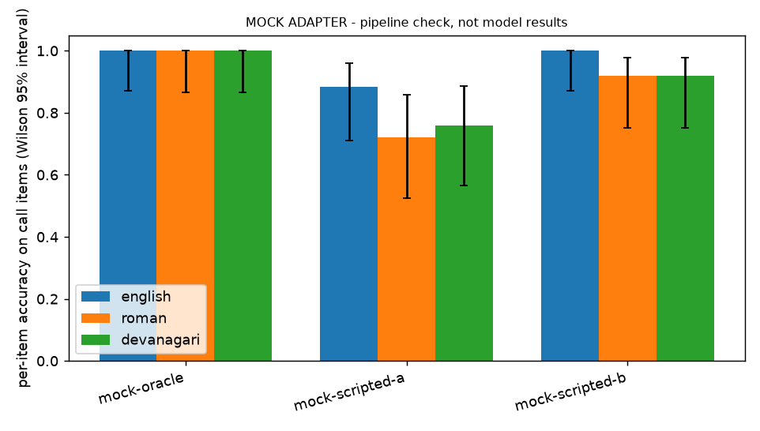
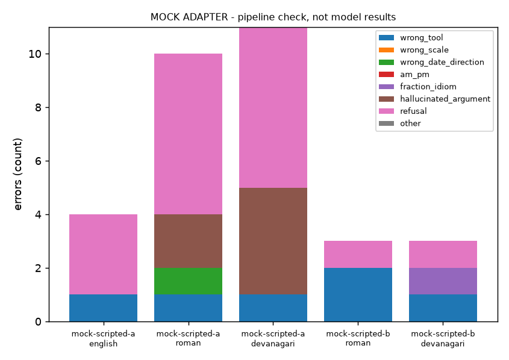

# Run `pipeline_check_mock`

> **This is a pipeline check with a mock adapter.** The "model" reads the gold answers and makes scripted mistakes. Nothing below is a model result and nothing below may be quoted.

> **Items are the AI-drafted seed set**, not the benchmark. No native speaker wrote or labelled them.

- Started 2026-11-14T13:53:21+00:00, finished 2026-11-14T13:53:22+00:00, complete: True
- Items: `bench/items/seed_v0.jsonl` (40 scenarios, 120 rows, sha256 `3c1fb38080d9`), provenance ['ai_drafted']
- Commit `a21228ea58` (uncommitted changes present), kitna 0.1.0.dev0, prompt v1, seed 20261112, samples 1
- Models: `mock-oracle` (mock); `mock-scripted-a` (mock); `mock-scripted-b` (mock)

## Accuracy on items where a tool call is expected (temperature 0)

| model | condition | variant | items | per-item accuracy | 95% Wilson | strict grader | right tool | per-argument accuracy |
|---|---|---|---|---|---|---|---|---|
| mock-oracle | kitna_hints | english | 26 | 100.0% | 87.1% to 100.0% | 100.0% | 100.0% | 100.0% |
| mock-oracle | kitna_hints | roman | 25 | 100.0% | 86.7% to 100.0% | 100.0% | 100.0% | 100.0% |
| mock-oracle | kitna_hints | devanagari | 25 | 100.0% | 86.7% to 100.0% | 100.0% | 100.0% | 100.0% |
| mock-oracle | raw | english | 26 | 100.0% | 87.1% to 100.0% | 100.0% | 100.0% | 100.0% |
| mock-oracle | raw | roman | 25 | 100.0% | 86.7% to 100.0% | 100.0% | 100.0% | 100.0% |
| mock-oracle | raw | devanagari | 25 | 100.0% | 86.7% to 100.0% | 100.0% | 100.0% | 100.0% |
| mock-scripted-a | kitna_hints | english | 26 | 96.2% | 81.1% to 99.3% | 96.2% | 96.2% | 96.7% |
| mock-scripted-a | kitna_hints | roman | 25 | 84.0% | 65.3% to 93.6% | 84.0% | 88.0% | 82.8% |
| mock-scripted-a | kitna_hints | devanagari | 25 | 84.0% | 65.3% to 93.6% | 84.0% | 84.0% | 89.7% |
| mock-scripted-a | raw | english | 26 | 88.5% | 71.0% to 96.0% | 88.5% | 88.5% | 91.8% |
| mock-scripted-a | raw | roman | 25 | 72.0% | 52.4% to 85.7% | 72.0% | 76.0% | 72.4% |
| mock-scripted-a | raw | devanagari | 25 | 76.0% | 56.6% to 88.5% | 76.0% | 76.0% | 79.3% |
| mock-scripted-b | kitna_hints | english | 26 | 100.0% | 87.1% to 100.0% | 100.0% | 100.0% | 100.0% |
| mock-scripted-b | kitna_hints | roman | 25 | 96.0% | 80.5% to 99.3% | 96.0% | 96.0% | 96.6% |
| mock-scripted-b | kitna_hints | devanagari | 25 | 100.0% | 86.7% to 100.0% | 100.0% | 100.0% | 100.0% |
| mock-scripted-b | raw | english | 26 | 100.0% | 87.1% to 100.0% | 100.0% | 100.0% | 100.0% |
| mock-scripted-b | raw | roman | 25 | 92.0% | 75.0% to 97.8% | 92.0% | 92.0% | 87.9% |
| mock-scripted-b | raw | devanagari | 25 | 92.0% | 75.0% to 97.8% | 92.0% | 96.0% | 89.7% |

"Strict grader" accepts only the machine format the tool schema asks for; the main column also accepts values the kitna parser can read (for example `2.5 lakh` or `6 PM`).

## Ambiguity items (scored separately): did the model ask or guess?

| model | condition | variant | items | asked | 95% Wilson | guessed |
|---|---|---|---|---|---|---|
| mock-oracle | kitna_hints | english | 9 | 100.0% | 70.1% to 100.0% | 0.0% |
| mock-oracle | kitna_hints | roman | 10 | 100.0% | 72.2% to 100.0% | 0.0% |
| mock-oracle | kitna_hints | devanagari | 10 | 100.0% | 72.2% to 100.0% | 0.0% |
| mock-oracle | raw | english | 9 | 100.0% | 70.1% to 100.0% | 0.0% |
| mock-oracle | raw | roman | 10 | 100.0% | 72.2% to 100.0% | 0.0% |
| mock-oracle | raw | devanagari | 10 | 100.0% | 72.2% to 100.0% | 0.0% |
| mock-scripted-a | kitna_hints | english | 9 | 100.0% | 70.1% to 100.0% | 0.0% |
| mock-scripted-a | kitna_hints | roman | 10 | 100.0% | 72.2% to 100.0% | 0.0% |
| mock-scripted-a | kitna_hints | devanagari | 10 | 70.0% | 39.7% to 89.2% | 30.0% |
| mock-scripted-a | raw | english | 9 | 100.0% | 70.1% to 100.0% | 0.0% |
| mock-scripted-a | raw | roman | 10 | 80.0% | 49.0% to 94.3% | 20.0% |
| mock-scripted-a | raw | devanagari | 10 | 60.0% | 31.3% to 83.2% | 40.0% |
| mock-scripted-b | kitna_hints | english | 9 | 100.0% | 70.1% to 100.0% | 0.0% |
| mock-scripted-b | kitna_hints | roman | 10 | 100.0% | 72.2% to 100.0% | 0.0% |
| mock-scripted-b | kitna_hints | devanagari | 10 | 100.0% | 72.2% to 100.0% | 0.0% |
| mock-scripted-b | raw | english | 9 | 100.0% | 70.1% to 100.0% | 0.0% |
| mock-scripted-b | raw | roman | 10 | 100.0% | 72.2% to 100.0% | 0.0% |
| mock-scripted-b | raw | devanagari | 10 | 100.0% | 72.2% to 100.0% | 0.0% |

## Negative items (scored separately): did the model call no tool?

| model | condition | variant | items | no tool called | 95% Wilson |
|---|---|---|---|---|---|
| mock-oracle | kitna_hints | english | 5 | 100.0% | 56.6% to 100.0% |
| mock-oracle | kitna_hints | roman | 5 | 100.0% | 56.6% to 100.0% |
| mock-oracle | kitna_hints | devanagari | 5 | 100.0% | 56.6% to 100.0% |
| mock-oracle | raw | english | 5 | 100.0% | 56.6% to 100.0% |
| mock-oracle | raw | roman | 5 | 100.0% | 56.6% to 100.0% |
| mock-oracle | raw | devanagari | 5 | 100.0% | 56.6% to 100.0% |
| mock-scripted-a | kitna_hints | english | 5 | 100.0% | 56.6% to 100.0% |
| mock-scripted-a | kitna_hints | roman | 5 | 100.0% | 56.6% to 100.0% |
| mock-scripted-a | kitna_hints | devanagari | 5 | 80.0% | 37.6% to 96.4% |
| mock-scripted-a | raw | english | 5 | 80.0% | 37.6% to 96.4% |
| mock-scripted-a | raw | roman | 5 | 80.0% | 37.6% to 96.4% |
| mock-scripted-a | raw | devanagari | 5 | 80.0% | 37.6% to 96.4% |
| mock-scripted-b | kitna_hints | english | 5 | 100.0% | 56.6% to 100.0% |
| mock-scripted-b | kitna_hints | roman | 5 | 100.0% | 56.6% to 100.0% |
| mock-scripted-b | kitna_hints | devanagari | 5 | 100.0% | 56.6% to 100.0% |
| mock-scripted-b | raw | english | 5 | 100.0% | 56.6% to 100.0% |
| mock-scripted-b | raw | roman | 5 | 80.0% | 37.6% to 96.4% |
| mock-scripted-b | raw | devanagari | 5 | 80.0% | 37.6% to 96.4% |

## English vs. Hindi variants on the same scenarios (paired, exact McNemar, Holm-adjusted)

| model | comparison | pairs | only English right | only other right | difference (95% bootstrap) | p | p (Holm) | significant |
|---|---|---|---|---|---|---|---|---|
| mock-oracle | english_vs_roman | 25 | 0 | 0 | +0.0 pts (+0.0 to +0.0) | 1.0000 | 1.0000 | no |
| mock-oracle | english_vs_devanagari | 25 | 0 | 0 | +0.0 pts (+0.0 to +0.0) | 1.0000 | 1.0000 | no |
| mock-scripted-a | english_vs_roman | 25 | 6 | 2 | +16.0 pts (-4.0 to +36.0) | 0.2891 | 1.0000 | no |
| mock-scripted-a | english_vs_devanagari | 25 | 6 | 3 | +12.0 pts (-12.0 to +36.0) | 0.5078 | 1.0000 | no |
| mock-scripted-b | english_vs_roman | 25 | 2 | 0 | +8.0 pts (+0.0 to +20.0) | 0.5000 | 1.0000 | no |
| mock-scripted-b | english_vs_devanagari | 25 | 2 | 0 | +8.0 pts (+0.0 to +20.0) | 0.5000 | 1.0000 | no |

## Ablation: kitna-parsed values added to the prompt vs. the raw utterance

| model | variant | pairs | only with hints right | only raw right | difference (95% bootstrap) | p (Holm) | significant |
|---|---|---|---|---|---|---|---|
| mock-oracle | english | 26 | 0 | 0 | +0.0 pts (+0.0 to +0.0) | 1.0000 | no |
| mock-oracle | roman | 25 | 0 | 0 | +0.0 pts (+0.0 to +0.0) | 1.0000 | no |
| mock-oracle | devanagari | 25 | 0 | 0 | +0.0 pts (+0.0 to +0.0) | 1.0000 | no |
| mock-scripted-a | english | 26 | 2 | 0 | +7.7 pts (+0.0 to +19.2) | 1.0000 | no |
| mock-scripted-a | roman | 25 | 3 | 0 | +12.0 pts (+0.0 to +28.0) | 1.0000 | no |
| mock-scripted-a | devanagari | 25 | 2 | 0 | +8.0 pts (+0.0 to +20.0) | 1.0000 | no |
| mock-scripted-b | english | 26 | 0 | 0 | +0.0 pts (+0.0 to +0.0) | 1.0000 | no |
| mock-scripted-b | roman | 25 | 1 | 0 | +4.0 pts (+0.0 to +12.0) | 1.0000 | no |
| mock-scripted-b | devanagari | 25 | 2 | 0 | +8.0 pts (+0.0 to +20.0) | 1.0000 | no |

## Error types (automatic classification, raw condition)

| model | variant | wrong_tool | wrong_scale | wrong_date_direction | am_pm | fraction_idiom | hallucinated_argument | refusal | other |
|---|---|---|---|---|---|---|---|---|---|
| mock-scripted-a | english | 1 | 0 | 0 | 0 | 0 | 0 | 3 | 0 |
| mock-scripted-a | roman | 1 | 0 | 1 | 0 | 0 | 2 | 6 | 0 |
| mock-scripted-a | devanagari | 1 | 0 | 0 | 0 | 0 | 4 | 6 | 0 |
| mock-scripted-b | roman | 2 | 0 | 0 | 0 | 0 | 0 | 1 | 0 |
| mock-scripted-b | devanagari | 1 | 0 | 0 | 0 | 1 | 0 | 1 | 0 |

The classifier is rule-based. `manual_review_sample.csv` is a seeded sample for a person to check it; until someone fills it in, treat these counts as unverified.

## Kill criterion

Not evaluated (not evaluated: this is not a real run; the criterion applies to real models on the human-written benchmark, see `docs/analysis_plan.md`).

